# SNC College website — staff guide to WordPress

**For:** Shiv Narayan Choubisa College office staff
**Version:** 2.0 (12 October 2026)
**Address:** `https://cms.snccollegedpr.in/wp-admin` (on the office computer during testing:
`http://localhost:8881/wp-admin`)

Every menu name, box name and button name in this guide is written exactly as it appears on
the screen. If something on your screen is named differently, the website has been changed
since this guide was written — tell the development team rather than guessing.

---

## The one rule

**Never type a number, a name or a date you have not checked.** Fees, examination dates,
staff names, phone numbers, a NAAC grade, a review — if you are not reading it off an
official paper, leave the box empty. An empty box is safe: the website simply leaves that
part out. A guessed value is published to the public as if the college had said it.

---

## 1. Logging in

1. Open `https://cms.snccollegedpr.in/wp-admin` in your browser.
2. Type your username and password and click **Log In**.

You now see the Dashboard. The black menu down the left side is where everything happens.

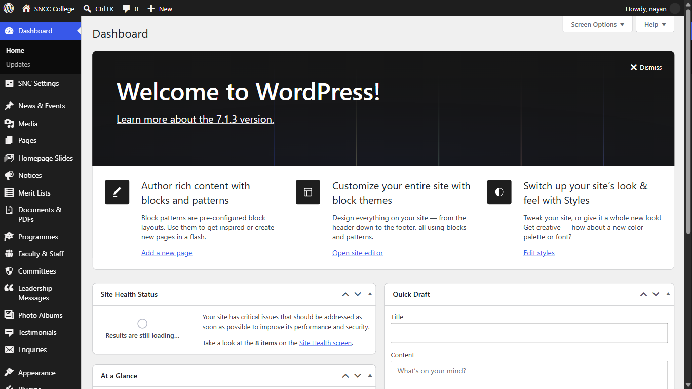

**You do not have to publish the website.** When you click Publish or Update, the public
website updates itself within a few seconds. There is no second step.

---

## 2. What each menu does

| Left menu | What goes in it |
|---|---|
| **SNC Settings** | Phone numbers, address, office hours, social links, admission status, homepage text |
| **Homepage Slides** | The large banner images at the top of the home page |
| **Notices** | Official notices and circulars |
| **Merit Lists** | Admission merit lists and waiting lists |
| **Documents & PDFs** | Syllabus, question papers, forms, calendars, reports, disclosures |
| **Programmes** | B.A. and B.Sc. — subjects, duration, eligibility |
| **Faculty & Staff** | Teaching and non-teaching staff |
| **Committees** | Committee members and office orders |
| **Leadership Messages** | Chairman's and Principal's messages |
| **Photo Albums** | Event photo galleries |
| **Testimonials** | Google reviews shown on the home page |
| **News & Events** | News items, event reports, press notes |
| **Enquiries** | Enquiry forms sent by students through the website (read only) |

---

## 3. Publishing a notice

1. **Notices** → **Add New**.
2. **Title** — the subject of the notice, for example
   `Submission of examination forms for Semester II`.
3. **Notice PDF** — click to upload the scanned circular. The file size is worked out
   automatically; you do not type it.
   *If the notice lives on another website (GGTU, for example), leave the PDF empty and put
   the address in **Or external link** instead.*
4. **Mark as important** — tick this only for notices that genuinely matter to every student.
   Ticked notices get an orange "Important" badge and go to the top of the home page notice
   board.
5. In the right-hand column, tick one **Notice Type**: Admission, Examination, Scholarship,
   Academic, Events or General. This decides which tab the notice appears under.
6. Click **Publish**.

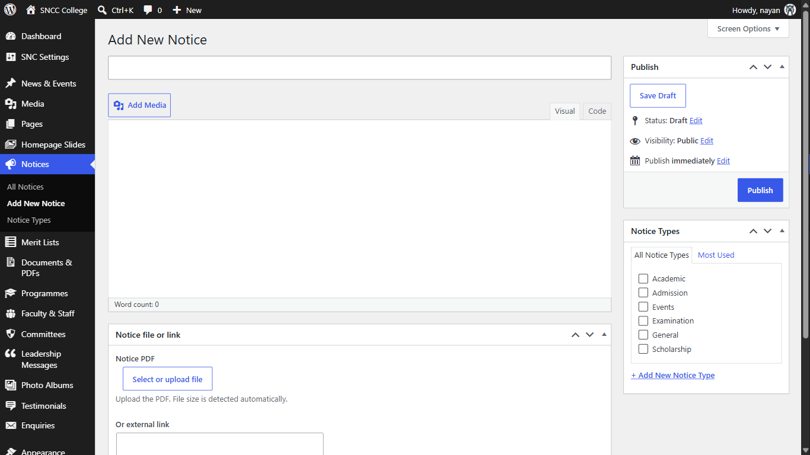

It appears immediately on the home page notice board and on `/students/notices`.

---

## 4. Publishing a merit list

1. **Merit Lists** → **Add New**.
2. **Title** — describe it fully, for example
   `B.A. Part I Merit List 1 (General) 2026-27`.
3. **List PDF** — upload the list. This one is required.
4. In the right-hand column tick **all four** boxes, or the list will not show up under the
   filters students use:
   - **Sessions** — `2026-27`, `2025-26` or `2024-25`
   - **Programme Tags** — `B.A.` or `B.Sc.`
   - **List Types** — Merit List, Waiting List, Provisional Admitted List, Final Admitted
     List or Other
   - **Categories** — All Categories, General, OBC, SC, ST, EWS, MBC or Divyang
5. Click **Publish**.

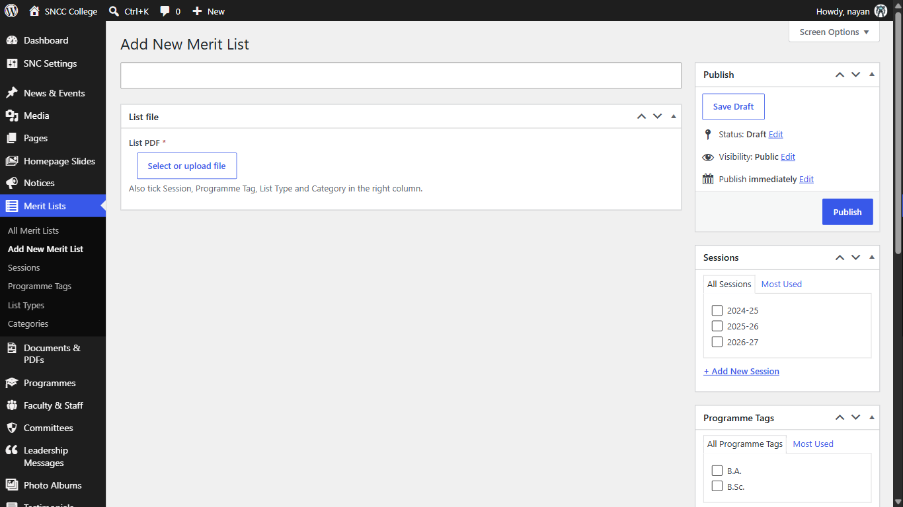

If a session you need is missing from **Sessions**, type it into the "Add new" box in that
panel using the same `2027-28` pattern.

---

## 5. Uploading a document

1. **Documents & PDFs** → **Add New**.
2. **Title** — for example `B.A. Syllabus 2026-27` or `Academic Calendar 2026-27`.
3. **File** — upload the PDF. (Or use **Or external link** for a file on another website.)
4. In the right-hand column tick one **Document Type**. This decides which page it appears
   on:

   | Document Type | Appears on |
   |---|---|
   | Syllabus | `/students/syllabus` |
   | Question Paper | `/students/question-papers` |
   | Form | `/students/downloads` |
   | Academic Calendar | `/academics/academic-calendar` |
   | Mandatory Disclosure | `/about/mandatory-disclosures` |
   | NAAC | `/iqac/naac` |
   | AQAR | `/iqac/reports` |
   | Annual Report | `/iqac/reports` |
   | AISHE Report, Fee Structure, Committee Order, Anti-Ragging, UGC / Statutory Compliance, Other | the matching page |

5. Also tick **Sessions** and **Programme Tags** where they apply, so the year and programme
   filters work.
6. Click **Publish**.

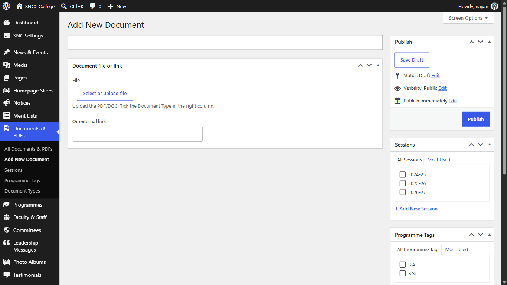

---

## 6. Adding a news item or event report

1. **News & Events** → **Add News Item**.
2. **Title** — the headline.
3. Type the report in the main editing box.
4. Right-hand column, **Categories** — tick News, Events or Press Notes.
5. Right-hand column, **Featured image** — click **Set featured image** and upload one clear
   photograph of the event. Use the college's own photograph, never a picture from the
   internet.
6. Click **Publish**.

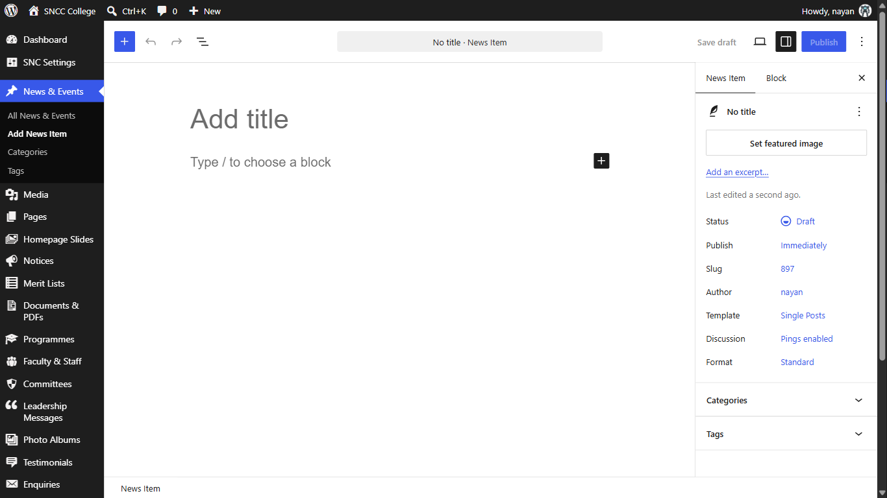

---

## 7. Creating a photo album

1. **Photo Albums** → **Add New**.
2. **Title** — for example `Annual Sports Week 2026`.
3. **Featured image** (right-hand column) — the single photo shown on the album card.
4. **Album photos** — click to select or upload the photos for the album. Five to fifteen
   good photographs work better than fifty ordinary ones.
5. Give each photo a caption in the media window as you upload it; captions appear under the
   photo on the website.
6. Click **Publish**.

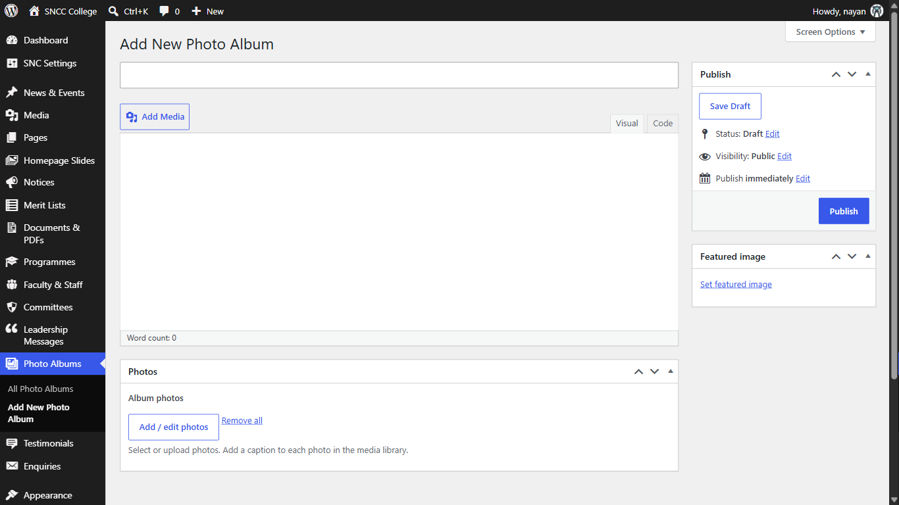

---

## 8. Adding a staff member

1. **Faculty & Staff** → **Add New**.
2. **Title** — the person's full name as it appears on official records.
3. **Designation** — for example `Assistant Professor (Chemistry)`.
4. **Qualification** — for example `M.Sc., B.Ed., Ph.D.`
5. **Experience** — for example `8 years`. Leave it empty if you are not sure.
6. **Email** and **Show email on the website** — the email is published **only** if you tick
   the box. Ask the person first.
7. Right-hand column: tick a **Department** (Arts, Science or Administration) and a **Staff
   Type** (Teaching or Non-teaching).
8. **Featured image** — a passport-style photograph on a plain background.
9. **Order** (right-hand column, under "Page Attributes") — a lower number appears first.
10. Click **Publish**.

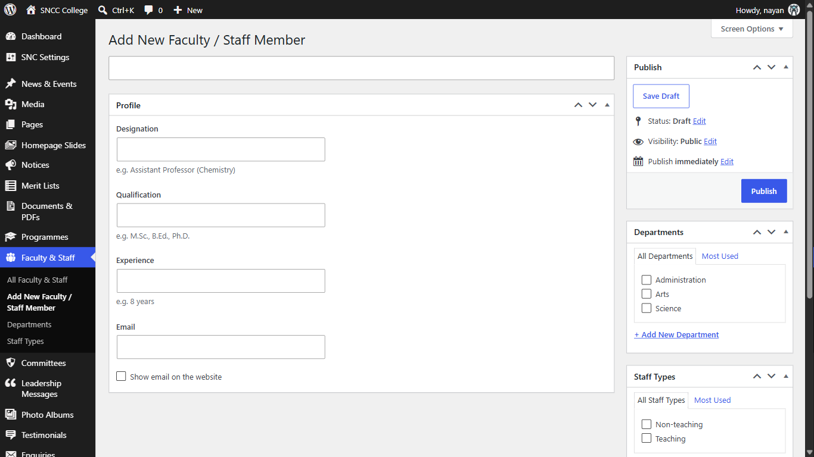

---

## 9. Adding a homepage banner slide

1. **Homepage Slides** → **Add New**.
2. **Title** — for your own reference only; it is not shown on the website.
3. **Desktop image** — 1920 × 720 pixels, landscape. Required.
4. **Mobile image** — 1080 × 1350 pixels, upright. Optional; the desktop image is used if you
   leave it empty.
5. If the image already has writing on it, leave all the text boxes empty. Otherwise fill in
   **Small label above heading**, **Heading** and **Supporting text**, and up to two buttons.
6. **Order** — a lower number shows first. A maximum of five slides are shown.
7. Click **Publish**.

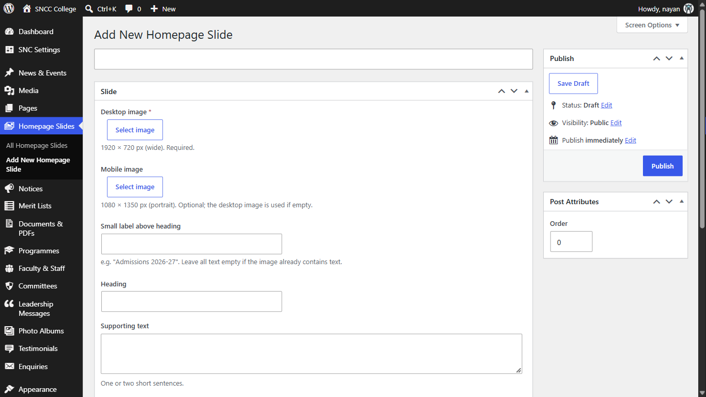

With no slides published at all, the home page shows the college name and emblem instead.
That is normal and correct.

---

## 10. Adding a committee

1. **Committees** → **Add New**.
2. **Title** — the committee's name, for example `Anti-Ragging Committee 2026-27`.
3. Type the committee's purpose in the main editing box.
4. **Convener** — the convener's name and designation.
5. **Members** — add a row for each person with their name, designation and role.
6. **Office order PDF** — upload the signed order if you have it.
7. Right-hand column — tick the **Session**.
8. Click **Publish**.

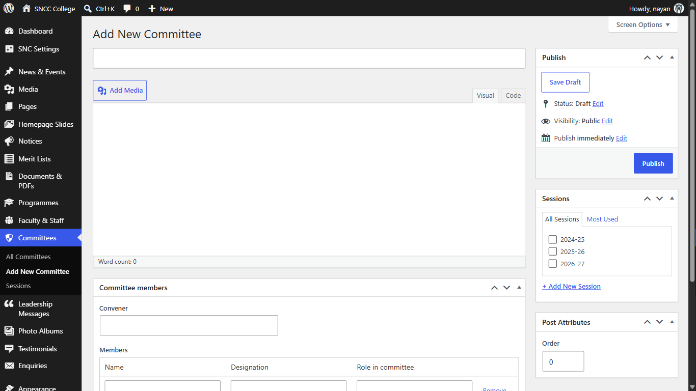

> **Important — tick the Session on every committee or on none.** The committees page shows
> one session at a time. While no committee has a session ticked, the page lists them all.
> As soon as you tick a session on even one committee, the page switches to showing that
> session only, and every committee without a session ticked disappears from the website.
> So when you start tagging sessions, finish the job in the same sitting.

---

## 11. Changing phone numbers, hours, admission status and homepage text

Click **SNC Settings**. Everything is on one page, in boxes you scroll through. Change what
you need and click **Save settings** at the bottom — one button saves the whole page.

| Box | What is in it |
|---|---|
| **College identity** | College name, College logo, College name in Hindi, Short description, Affiliating university |
| **Contact details** | Admission phone, Office phone, WhatsApp number, Email, Address, Google Maps link, Google Maps embed URL, Office hours |
| **Social media** | Facebook URL, Instagram URL, YouTube URL |
| **Admissions** | Current admission session, **Admissions are open** tick box, Apply Now link |
| **Homepage** | About section text and photo, "Why choose SNC" cards, Key facts, Admission banner |
| **Reviews** | Google rating, Number of Google reviews, Link to the Google listing |
| **Search & sharing** | Default share image (1200 × 630), used when a page has no photo of its own |

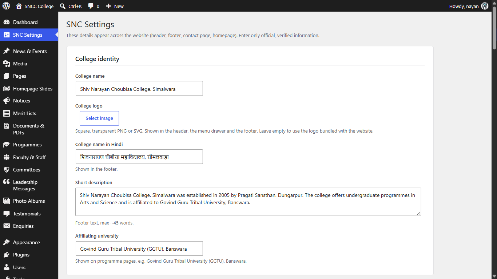

Two to know:

- **Admissions are open** is the tick box that puts "Admissions Open" in the website header.
  Untick it the day admissions close.
- **Key facts** must only contain numbers the college can prove. Leave a row empty rather
  than estimating.

Only an Administrator account can open **SNC Settings**. Staff accounts set up as Editors can
do everything else in this guide but will not see this menu.

---

## 12. Putting Google reviews on the home page

The reviews section stays hidden until you fill in both the score and at least one review.
That is deliberate.

**First, the score:** **SNC Settings** → **Reviews** → fill in **Google rating** (for example
`4.2`), **Number of Google reviews** and **Link to the Google listing**, then **Save
settings**.

**Then each review:** **Testimonials** → **Add New**.

1. **Title** — the reviewer's name, spelled exactly as Google shows it.
2. Main editing box — the review text, copied exactly. Do not tidy it up or shorten it.
3. **Where this review came from** — choose `Google review`.
4. **Star rating** — as given on Google.
5. **Review date** — in `YYYY-MM-DD` form, for example `2026-08-12`.
6. **Link to the original review** — the Google permalink. This is required for Google
   reviews so that any visitor can check it.
7. **Cleared to publish** — tick it. **Nothing appears on the website until this is ticked.**
8. Click **Publish**.

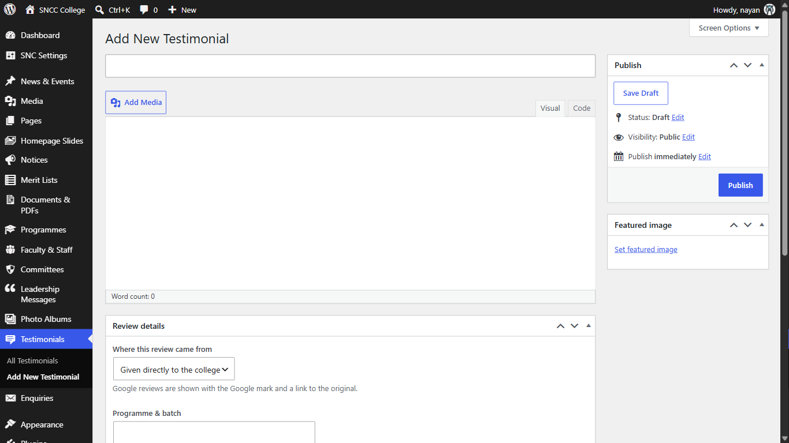

Never write a review yourself, and never adjust a score. Copy what Google shows, or publish
nothing.

---

## 13. Reading student enquiries

Click **Enquiries**. Every enquiry sent through the website's contact and admission forms is
listed here with the student's name, phone number, email, the programme they asked about, the
message and the date. Open one to read it in full and then phone or WhatsApp the student.

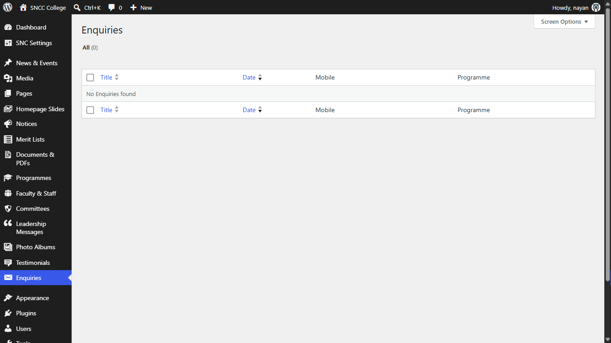

These are private; they are never shown on the website. You cannot create an enquiry by hand,
only read what students have sent.

---

## 14. Correcting a mistake

- **Wrong text or wrong file:** open the item, fix it, click **Update**. The website changes
  within seconds.
- **Published by accident:** open the item and click **Move to Trash**. It disappears from the
  website at once, and stays in the Trash for 30 days if you need it back.
- **Not sure yet:** click **Save draft** instead of Publish. Drafts are never public.

---

## 15. When to stop and ask

Stop and contact the development team if:

- a menu or box named in this guide is not on your screen;
- the website does not change within a minute of clicking Publish;
- you are about to type a figure, a grade or a date that is not on an official paper;
- you need a box that does not exist, for example a new kind of document.

Contact details for the development team are in `OPERATIONS-RUNBOOK.md`.
